<!-- README built from framework/templates/README-template.md -->

# 🚀 Day 72: Data Exploration with Pandas

A Jupyter notebook and a small, tested Python package that explore the PayScale post-university salary data by college major, from Udemy's *100 Days of Code: The Complete Python Pro Bootcamp*. It is for coursists who want to run and compare solutions, and for visitors who browse for ideas.

## 📚 Table of Contents

- [Overview](#-overview)
- [Requirements](#-requirements)
- [Setup](#-setup)
- [Run](#-run)
- [Tests](#-tests)
- [License](#-license)
- [Links](#-links)
- [Appendix: Project documents](#-appendix-project-documents)

## 🧭 Overview

Do college degrees pay you back? The notebook answers five questions with pandas:

| Question | Answer |
| --- | --- |
| 1. Which degrees have the highest starting salaries? | Physician Assistant (74,300), then Chemical, Computer, Electrical and Mechanical Engineering |
| 2. Which majors have the lowest earnings after college? | Spanish, Religion and Education start lowest; Education and Religion earn least in mid-career (52,000) |
| 3. Which degrees have the highest earning potential? | Economics (210,000 at the 90th percentile), Finance, Chemical Engineering, Math, Physics |
| 4. What are the lowest-risk majors? | Nursing (smallest spread, 50,700), then Physician Assistant, Nutrition, Spanish, Health Care Administration |
| 5. Do Business, STEM or HASS earn more? | STEM (mid-career 90,800), then Business (75,100), then HASS (63,000) |

| Folder | What it holds |
| --- | --- |
| `notebooks/` | `day_72_data_exploration.ipynb`, the five answers at the top, then the lecture steps in order, with outputs |
| `src/college_majors/` | The tested functions, one per lecture step (clean architecture layers) |
| `src/college_majors/data/` | `salaries_by_college_major.csv` (source: PayScale Inc., via the course) and `payscale_majors_wayback.csv` (350 majors, PayScale snapshot of 13-14 February 2020 from the Wayback Machine) |
| `tests/` | Unit, integration and end-to-end tests; the notebook is executed in a test |
| `tools/` | `make_screenshots.py`, which renders the step images from the notebook |
| `docs/` | Project documents, step images and the wiki (English, Danish, Bahasa Malaysia) |

Function names follow the assignment:

| Lecture step | Function |
| --- | --- |
| `df.head()`, `df.tail()` | `head`, `tail` |
| `df.shape`, `df.columns` | `shape`, `columns` |
| `df.isna()` | `missing_values` |
| `df.dropna()` | `clean` |
| `answer_five_questions` | One answer per question (step 11) |
| `compare_with_2008`, `biggest_gainers`, `biggest_losers`, `where_is` | Extra credit: 2008 against newer PayScale data (step 12) |
| `max`, `idxmax`, `loc` | `highest_starting_salary`, `highest_mid_career_salary` |
| `min`, `idxmin` | `lowest_starting_salary`, `lowest_mid_career_salary` |
| `insert` (Spread column) | `add_spread` |
| `sort_values` | `lowest_risk_majors`, `highest_potential_majors`, `greatest_spread_majors` |
| `groupby` | `majors_per_group`, `average_salary_by_group` |

## 📋 Requirements

- Python 3.13 or newer.
- `pandas`, the only runtime dependency.
- Optional, for the notebook: JupyterLab (the `notebook` extra). Optional, for the tests: pytest (the `dev` extra).

## 🛠️ Setup

Create a local virtual environment named `.venv`, upgrade pip, and install the project.

Windows (PowerShell):

```powershell
python -m venv .venv
.venv\Scripts\Activate.ps1
python -m pip install --upgrade pip
python -m pip install -e ".[dev,notebook]"
```

Linux and macOS:

```bash
python3 -m venv .venv
source .venv/bin/activate
python -m pip install --upgrade pip
python -m pip install -e ".[dev,notebook]"
```

Install only `pip install -e .` if you want the package without Jupyter and pytest.

## ▶️ Run

Open the notebook in JupyterLab:

```bash
python -m jupyter lab notebooks/day_72_data_exploration.ipynb
```

Or print every lecture step in the terminal:

```bash
python -m college_majors
```


### Screenshots of the lecture steps

Generated from the executed notebook by `python tools/make_screenshots.py`. The [wiki][documentation] explains what each step taught, in English, Danish and Bahasa Malaysia.

**Step 1: Read the .csv file and look at the first rows**

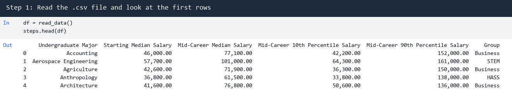

**Step 2: Shape and column names**

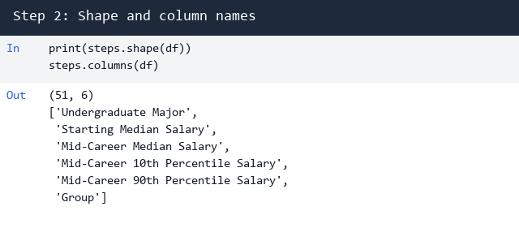

**Step 3: Missing values**

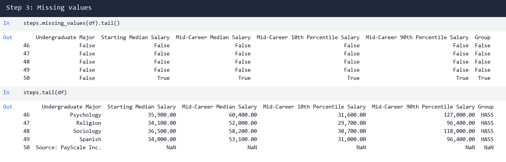

**Step 4: Clean the data**

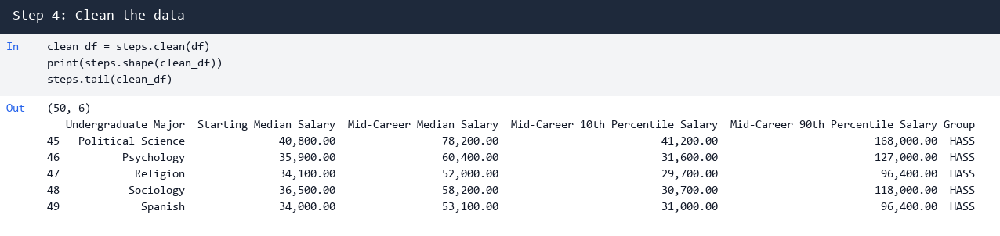

**Step 5: Highest starting salary**

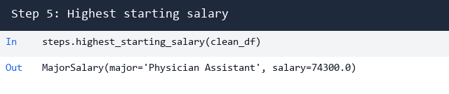

**Step 6: Highest mid-career salary and the lowest earners**

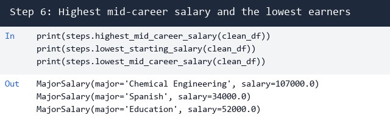

**Step 7: Spread and the lowest-risk majors**

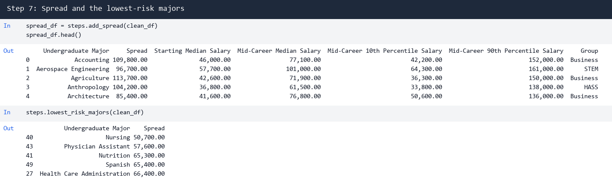

**Step 8: Highest potential and greatest spread**

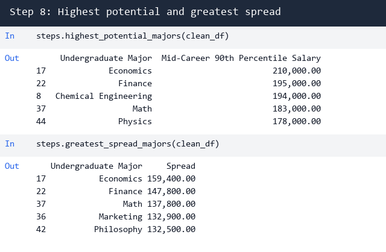

**Step 9: Group by category**

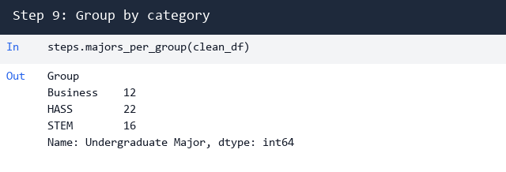

**Step 10: Average salary by group**

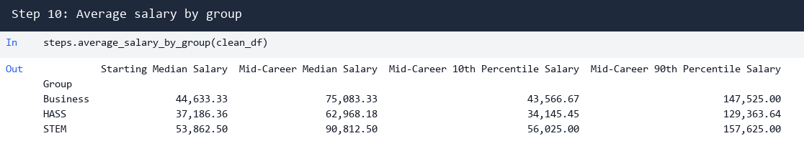

**Step 11: Answers to the five questions**

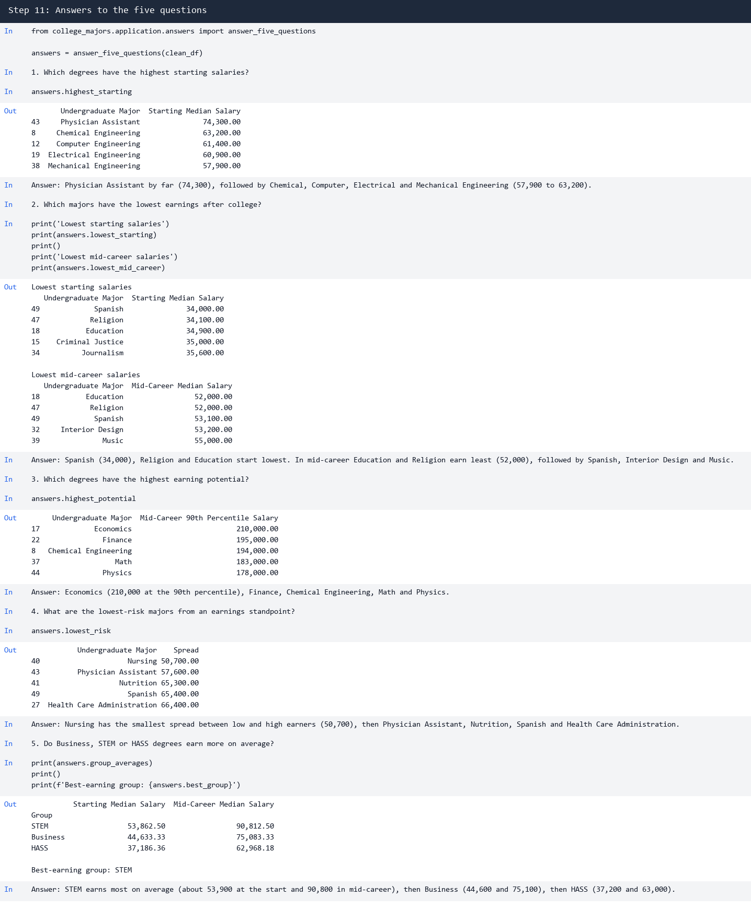

**Step 12: Extra credit, what changed since 2008**

The lecture notes that PayScale's site is paywalled, so the newer data comes from the Wayback Machine. It is a 2020 snapshot, not today's data, and only the 23 of 50 majors with the same name in both sets can be compared. Technology majors gained most in mid-career pay (Management Information Systems +28.6%, Information Technology +23.1%, Computer Science +20.1%), no compared major fell, and Finance moved from rank 14 of 50 to rank 169 of 350.

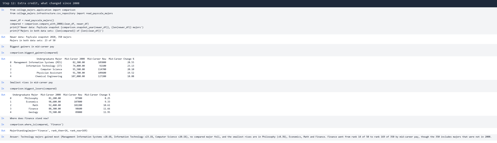

To scrape the data again (standard library only, one polite request per page, never run by the tests):

```bash
python -m college_majors --scrape-wayback payscale.csv
```

## 🧪 Tests

```bash
python -m pytest --cov=college_majors
```

The tests run offline and execute the notebook end to end.

## 📄 License

GNU Affero General Public License v3, see [LICENSE][license].

## 🔗 Links

- [Repository][repository]
- [Documentation][documentation]
- [Issue tracker][issues]

## 📎 Appendix: Project documents

The documents a newcomer needs, in reading order.

| Document | What it tells you |
| --- | --- |
| [Business Case][BC-001] | Why the project exists, its scope and success criteria |
| [Stakeholder Analysis][SA-001] | Who is involved; the stakeholder IDs used for owners and reviewers |
| [Project Plan][PP-001] | The gateways and their schedule |
| [Milestones][milestones] | One document per gateway: Go/No-Go criteria and tasks |
| [Artifact registry][registry] | Where each artifact type lives, the next version, the PO language and domain |
| [Domain dictionary][DICT-001] | The PO terms and the IT terms |
| [Traceability matrix][TM-001] | How the artifacts link and when each was last reviewed |
| [Framework README][framework-readme] | The framework this project uses |
| [Framework changelog][framework-changelog] | What changed in each framework release |

---

[license]: ./LICENSE
[repository]: https://git.tirsystem.com/Tirsvad-Udemy-100-days-of-code/072-data-exploration-with-pandas
[documentation]: https://git.tirsystem.com/Tirsvad-Udemy-100-days-of-code/072-data-exploration-with-pandas/wiki
[issues]: https://git.tirsystem.com/Tirsvad-Udemy-100-days-of-code/072-data-exploration-with-pandas/issues
[BC-001]: ./docs/business-case.md
[SA-001]: ./docs/stakeholder-analysis.md
[PP-001]: ./docs/project-plan.md
[milestones]: ./docs/milestones/
[registry]: ./docs/artifact-registry.md
[DICT-001]: ./docs/dictionary.md
[TM-001]: ./docs/sqa/traceability-matrix.md
[framework-readme]: ./framework/README.md
[framework-changelog]: ./framework/CHANGELOG.md
