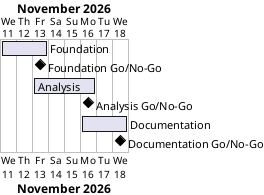

# Day 72 Pandas Project Plan

## Metadata
| Key | Value |
| --- | --- |
| ID | PP-001 |
| CrossReference | [BC-001], [SA-001] |
| Language | en |
| Domain | it |

## Version History
| Date | Status | Author | Reviewer | Change | Commit |
| --- | --- | --- | --- | --- | --- |
| 2026-11-11 | Accepted | Jens Tirsvad Nielsen | S02 (AI as stand-in) | Initial version | [b409b30] |

---
## Purpose

This plan schedules three gateways that deliver the Day 72 project by the Business Case target date of 2026-11-18.

## Planning Assumptions

- Week 1 starts 2026-11-11; the plan ends by 2026-11-18, per the Business Case constraint.
- Each gateway is one pull request, merged after green checks (source: the autonomous-mode rules of `AGENTS.md`).
- Owner S01 and approving reviewer S02 follow the Stakeholder Analysis; the project has no governance document, so the RACI is the one in each `MIL-*` (source: [SA-001]).

## Gateway Schedule

| Gateway | Document | Window | Decision date | Owner | Stories | Main deliverable | Milestone |
| --- | --- | --- | --- | --- | --- | --- | --- |
| Foundation | [MIL-001] | 2026-11-11 to 2026-11-13 | 2026-11-13 | S01 | none | Baseline documents, project skeleton, data, loader and cleaning | |
| Analysis | [MIL-002] | 2026-11-13 to 2026-11-16 | 2026-11-16 | S01 | none | All lecture-step functions, Jupyter notebook, CLI and tests | |
| Documentation | [MIL-003] | 2026-11-16 to 2026-11-18 | 2026-11-18 | S01 | none | README, notebook screenshots, trilingual wiki, repository metadata | |



## Scope Coverage

| Business Case scope item | Gateway |
| --- | --- |
| Package, tests, pyproject, .gitignore, venv instructions, notebook skeleton | [MIL-001] |
| Loading and cleaning | [MIL-001] |
| All lecture steps and challenges, Jupyter notebook | [MIL-002] |
| README, screenshots, wiki in three languages | [MIL-003] |
| Repository description and topics, opengrep before push | [MIL-001], [MIL-003] |

## Dependencies

```
Foundation -> Analysis -> Documentation
```

A No-Go on a gateway moves the later dates by the rework time; S01 decides whether the end date moves.

The Milestone column of the schedule is empty because the milestones are not yet synced to the git host.

## Plan Risks

| Risk | Impact | Mitigation |
| --- | --- | --- |
| The dataset link has expired | Foundation cannot finish | Stop and ask S01 for the CSV |
| Tokens are rejected by the host | Cannot push or set metadata | Stop and report; never print the token |
| The dataset link has expired (Business Case risk 1) | Same as above | Same as above |
| Translations take longer than planned | Documentation slips | English first; translations page by page |

## Open Issues

- The repository named in the assignment (`Tirsvad-Udemy-100_days_of_code`) differs from the configured `origin` (`Tirsvad-Udemy-100-days-of-code/072-data-exploration-with-pandas`); the plan uses `origin`.

---

[BC-001]: ./business-case.md
[SA-001]: ./stakeholder-analysis.md
[MIL-001]: ./milestones/mil-001-foundation.md
[MIL-002]: ./milestones/mil-002-analysis.md
[MIL-003]: ./milestones/mil-003-documentation.md
[b409b30]: https://git.tirsystem.com/Tirsvad-Udemy-100-days-of-code/072-data-exploration-with-pandas/commit/b409b30d933875a01860e78a6a26ccda86d6a9b3
